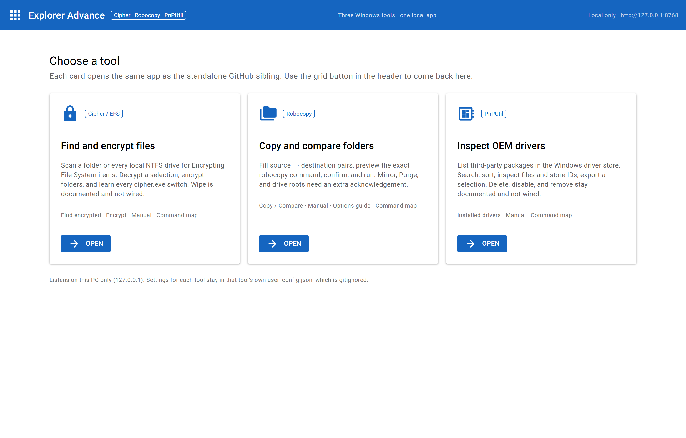

# Explorer Advance

One **NiceGUI** desktop app for three built-in Windows commands:

| Tool | What it wraps | Standalone sibling |
|---|---|---|
| **Cipher / EFS** | `cipher.exe` | [Advanced-Cipher](https://github.com/vnvlthm/Advanced-Cipher) |
| **Robocopy** | `robocopy.exe` | [Robocopy-advanced](https://github.com/vnvlthm/Robocopy-advanced) |
| **PnPUtil** | `pnputil.exe` | [PnPutil](https://github.com/vnvlthm/PnPutil) |

Open the app, pick a card, work as usual. The grid button in the header
returns to the picker. This is the same UI as each sibling, in one install.

## Screenshot



Three cards on the home page. Open one tool, then the grid button in the
header comes back here.

## Requirements

- Windows
- Python 3.10+
- NiceGUI

## Install

```powershell
py -3 -m pip install -r requirements.txt
```

## Run

From this folder:

```powershell
py -3 main.py
```

The UI listens on **http://127.0.0.1:8768** only (not on the LAN). If that
port is taken, the app picks the next free port and prints it. Or:

```powershell
py -3 main.py --port 8769
```

Each tool keeps its own gitignored `user_config.json` under `apps/<tool>/`.
Robocopy logs go under `apps/robocopy/logs/`.

## Layout

```
main.py                   # picker + routes
apps/cipher/              # Cipher / EFS
apps/robocopy/            # Robocopy
apps/pnputil/             # PnPUtil
```

You can still start one tool alone from its folder (`py -3 main.py` there).
The suite sets `EXPLORER_SUITE=1` so those copies show the grid button back
to the picker.

## Safety

Writes always show the exact command and ask for confirmation.

- Cipher: encrypt and decrypt are wired; wipe (`/W`) is not.
- Robocopy: copy, compare, Purge, and Mirror are wired; Purge, Mirror, and
  drive roots need an extra acknowledgement.
- PnPUtil: list, inspect, and export are wired; delete, disable, and remove
  are not.

See [SECURITY.md](SECURITY.md).

## License

MIT, CedricVV. See [LICENSE](LICENSE).
